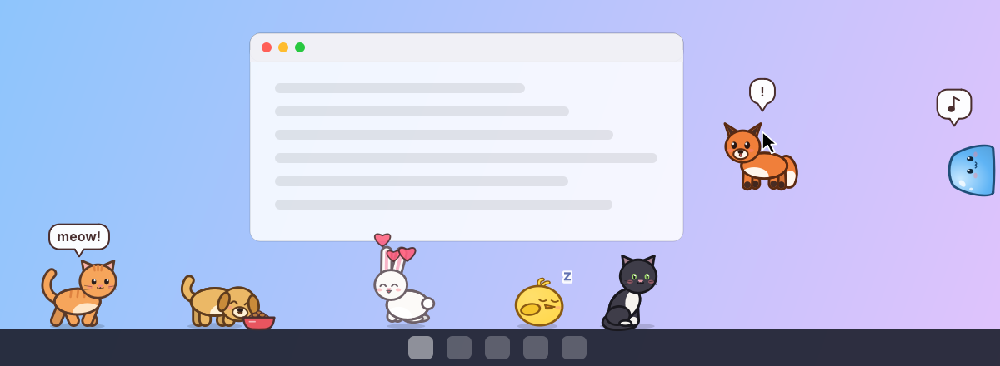
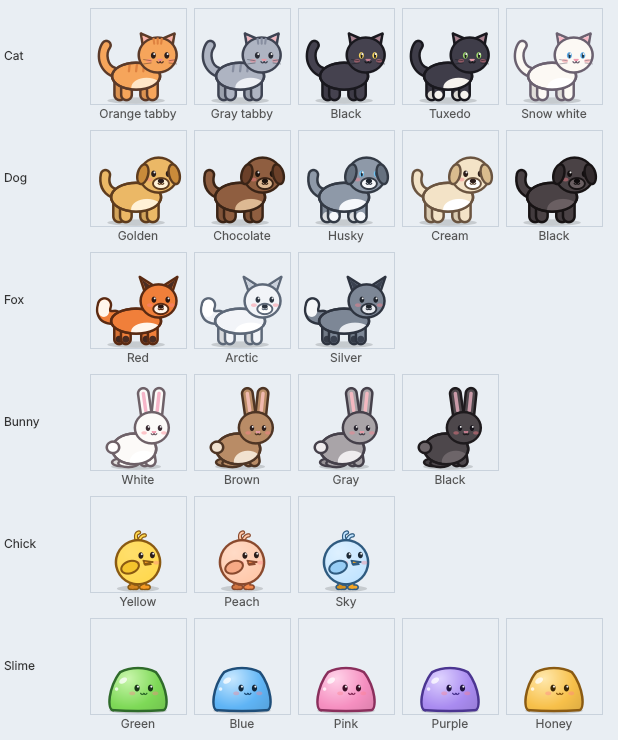

# PC Pet

Little pets that live on your desktop. They walk along the bottom of your screen (on top of the taskbar or dock), nap, chase your mouse, climb up the sides of the screen, and say hi to each other. You can pet them, feed them, and pick them up and throw them.

Works on **Windows**, **macOS** and **Linux**.



## The pets

Six species, each in several colors: **cat, dog, fox, bunny, chick and slime**. They're all drawn in code, so they stay sharp at any size and on high-DPI screens.



## What you can do

| Action | How |
| --- | --- |
| Pet | Click a pet. Hearts! |
| Pick up / throw | Drag a pet with the left mouse button. Let go while moving the mouse to throw it. |
| Pet menu | Right-click a pet (Ctrl+click on a Mac): feed, play, nap, rename, change color, add or remove pets, settings, quit. |
| Tray / menu bar icon | Add pets, feed everyone, hide or show all pets, settings, quit. |

What the pets do by themselves:

- Walk, run, sit and nap. They nap more when they're tired.
- Chase your mouse pointer now and then. With **Play** from the menu they chase it on purpose.
- Cats and slimes sometimes climb the edge of the screen, hang on for a bit, then let go.
- Two pets that meet say hi with a heart.
- They get hungry over time and will ask for food (a fish in a speech bubble). **Feed** puts down a bowl.
- When you open a pet's menu, that pet waits for you instead of walking away.

The status line at the top of a pet's menu shows its food, energy and happiness. Pets and settings are saved automatically, so they come back where you left them.

**Settings:** pet size (small to huge), speech bubbles on/off, and start at login.

## Install

### Download a ready-made app

Builds for each system are produced by GitHub Actions. You can download them from this repository's **Releases** page (for tagged versions) or from the **Actions** tab (open a CI run and look under *Artifacts*).

- **Windows:** unzip `pcpet-windows-x64.zip` and run `pcpet.exe`. The app isn't code-signed, so SmartScreen may warn you: click *More info → Run anyway*.
- **macOS (Apple Silicon):** unzip `pcpet-macos-arm64.zip` and move **PC Pet** to Applications. The app isn't signed or notarized, so the first time you need to right-click it and choose **Open**. If macOS says the app is damaged, run `xattr -dr com.apple.quarantine "/Applications/PC Pet.app"`. PC Pet shows up as a menu bar icon, not in the Dock. On Intel Macs, run from source (below).
- **Linux (x86-64):** extract `pcpet-linux-x64.tar.gz` and run `./pcpet`. If it complains about the Qt "xcb" plugin, install `libxcb-cursor0` (Debian/Ubuntu: `sudo apt install libxcb-cursor0`).

### Run from source (any OS)

You need Python 3.9 or newer.

```bash
git clone https://github.com/2lnly/pcpet.git
cd pcpet
python -m pip install -r requirements.txt
python -m pcpet
```

Or install it as a command with `python -m pip install .` and then run `pcpet`.

## Command line

```text
pcpet                     start (or, if already running, wave hello)
pcpet --add dog           add a pet: cat, dog, fox, bunny, chick, slime or random
                          (works while PC Pet is already running; repeat to add more)
pcpet --reset             forget all saved pets and settings
pcpet --no-tray           don't show a tray / menu bar icon
pcpet --config-dir DIR    keep saved pets somewhere else
pcpet --version
```

Only one copy runs at a time. Starting it again brings the existing pets back if they were hidden.

## Platform notes

- **Linux on Wayland:** Wayland doesn't let apps place their own windows, so PC Pet automatically runs through XWayland (`QT_QPA_PLATFORM=xcb`). This needs XWayland, which GNOME and KDE include.
- **Linux on X11:** transparency needs a compositor, which modern desktops have built in. Pet windows are unmanaged, so they don't appear in the taskbar or Alt+Tab and they're visible on every workspace. If your window manager misbehaves with that, start with `PCPET_X11_MANAGED=1 pcpet`.
- **Linux tray icon:** GNOME needs the *AppIndicator* extension to show tray icons. Without a tray, use a pet's right-click menu, which has everything including **Quit**. In that case the last pet can't be removed, so you can't lose the menu.
- **macOS:** pets appear on every Space, including full-screen apps.
- **Saved data** lives in your user config folder: `~/.config/pcpet` on Linux, `~/Library/Preferences/pcpet` on macOS, and `%LOCALAPPDATA%\pcpet` on Windows.
- **Start at login** creates `~/.config/autostart/pcpet.desktop` on Linux, `~/Library/LaunchAgents/io.github.pcpet.plist` on macOS, or a *Run* registry entry on Windows. If you move the app afterwards, toggle the setting off and on again.

## Development

```bash
python -m pip install -e ".[dev]"
python -m pytest                                     # unit tests (no display needed)
python -m pcpet --selftest 6                         # the real app with scripted clicks, drags and menus
python scripts/preview.py poses.png                  # every species in every pose
python scripts/screenshot.py docs/screenshot.png assets/icon.png
pyinstaller --noconfirm packaging/pcpet.spec         # standalone app in dist/ (pip install ".[build]")
```

CI (`.github/workflows/ci.yml`) runs the tests and the self-test on Linux, macOS and Windows, then builds and smoke-tests the standalone apps. Pushing a tag like `v1.0.0` publishes them as a GitHub release.

### How it's put together

| File | What it does |
| --- | --- |
| `pcpet/model.py` | Pet behaviour: a state machine plus simple physics (no Qt, easy to test) |
| `pcpet/species.py` | Species, colors, sounds and animation timing |
| `pcpet/art.py` | The vector drawings for every species and pose |
| `pcpet/render.py` | Turns poses into cached images, plus window masks for X11 |
| `pcpet/windows.py` | A transparent window per pet, plus a click-through layer for hearts, bubbles and the food bowl |
| `pcpet/manager.py` | The animation clock, screens, menus, tray icon and saving |
| `pcpet/effects.py` | Hearts, snores, dust and speech bubbles |
| `pcpet/storage.py`, `autostart.py`, `single_instance.py`, `platform_setup.py` | Saving, start-at-login, one-copy-only, and per-OS tweaks |

To add a species, give it an entry in `species.py` and a drawing in `art.py`. The tests check that every pose of every species draws inside its box.
